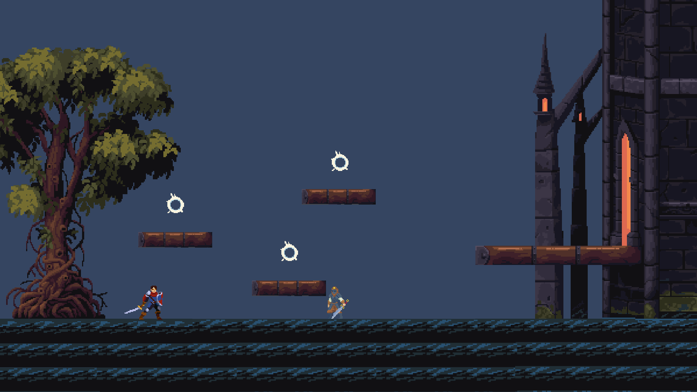

# Mario

2D-игра про рыцаря, который защищает свое королевство от захватчиков.

## Управление

Cтандартное управление передвижением персонажа:
- W, A, S, D - вверх, влево, вниз, вправо;
- ПРОБЕЛ - прыжок;
- Q - удар мечом;
- E - кинуть камень (если подобрать бонус).

## Цели и задачи

### Цели проекта
- Создание 2D-игры.
- Учебно-демонстрационная цель.

### Задачи проекта
- Разделить ответственности программы по классам.
- Реализовать управление персонажем.
- Реализовать систему бонусов.
- Реализовать боевую систему — ближний бой (меч) и дальний бой (камень).
- Реализовать врагов-захватчиков.
- Реализовать игровой мир/уровни.
